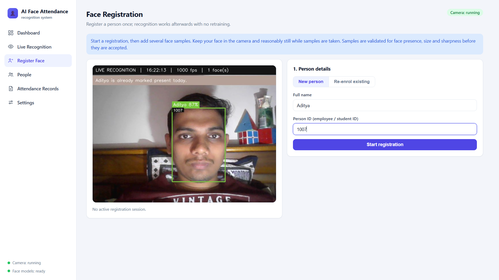
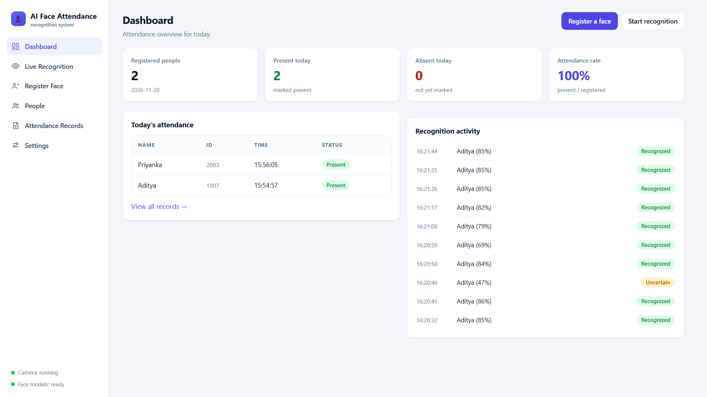
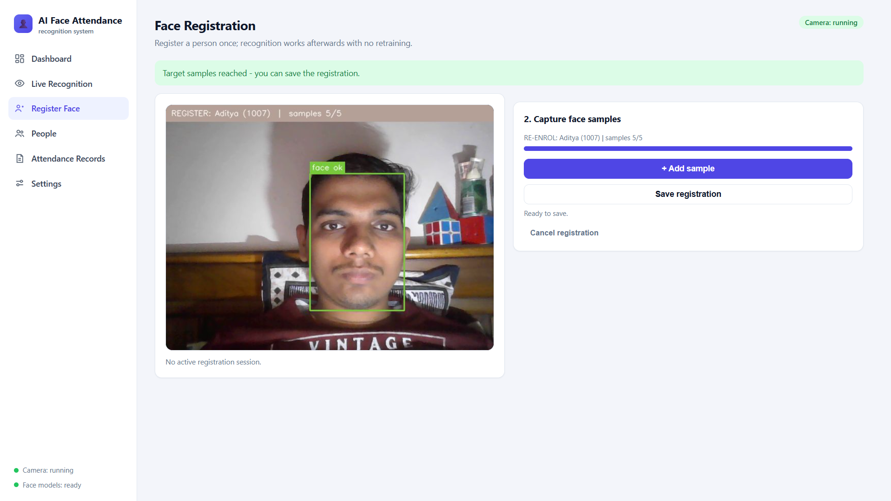
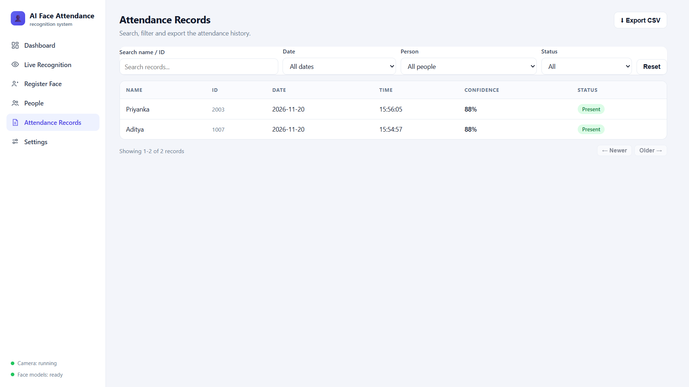
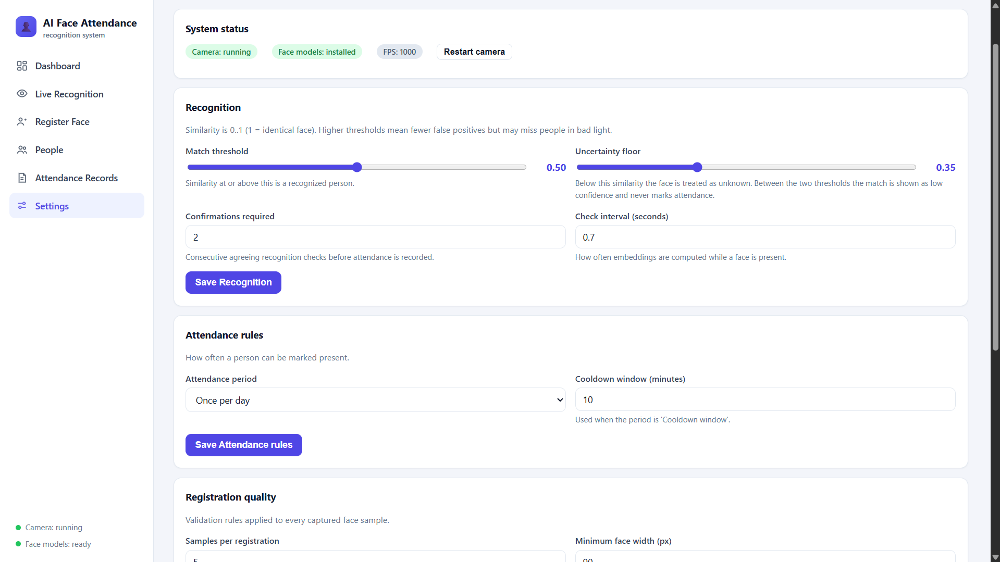

# Real-Time AI Face Recognition Attendance System

[](https://www.python.org/)
[](https://opencv.org/)
[](https://flask.palletsprojects.com/)
[](https://pytest.org/)
[](LICENSE)
[](#privacy--security-by-design)

An enterprise-grade, edge-deployable **AI Face Recognition Attendance System** powered by lightweight Deep Neural Networks (**YuNet** for multi-angle face detection and **SFace** for 128-dimensional latent facial embeddings).

Built with **Python**, **OpenCV DNN**, **Flask**, and **SQLite**, the system provides instant dynamic face enrollment with **zero model retraining**, sub-millisecond vectorized matching, automated multi-frame confirmation windows to prevent false positives, and concurrency-safe atomic attendance logging.

---

## 📸 System Architecture & Pipeline Flow

```
                      ┌─────────────────────────────────────────┐
                      │          Webcam / Video Stream          │
                      └────────────────────┬────────────────────┘
                                           │
                                           ▼
                      ┌─────────────────────────────────────────┐
                      │     YuNet Face Detection (ONNX)         │
                      │  - Multi-scale bounding box detection   │
                      │  - 5-point facial landmark alignment    │
                      └────────────────────┬────────────────────┘
                                           │
                                           ▼
                              [ Face Detected? ]
                                    /     \
                                 No/       \Yes
                                  ▼         ▼
                           (Idle/Pass) ┌────────────────────────┐
                                       │ Quality Verification   │
                                       │ - Laplacian Sharpness  │
                                       │ - Min Face Width (px)  │
                                       └───────────┬────────────┘
                                                   │
                                                   ▼
                                       ┌────────────────────────┐
                                       │ SFace Feature Extractor│
                                       │ - Deep metric learning │
                                       │ - 128-d unit embedding │
                                       └───────────┬────────────┘
                                                   │
                                                   ▼
                                       ┌────────────────────────┐
                                       │ In-Memory NumPy Gallery│
                                       │ Vectorized Cosine Sim: │
                                       │    sim = Matrix @ v    │
                                       └───────────┬────────────┘
                                                   │
               ┌───────────────────────────────────┼───────────────────────────────────┐
               │                                   │                                   │
               ▼                                   ▼                                   ▼
    [ sim >= 0.50 : MATCH ]             [ 0.35 <= sim < 0.50 ]                 [ sim < 0.35 ]
               │                            Uncertain Match                     Unknown Face
               ▼                         (Displayed in Amber;                (Displayed in Red;
    [ Confirmation Window ]              Never marks attendance)             Never marks attendance)
    - Must be recognized across
      consecutive frames (default: 2)
               │
               ▼
    [ Atomic SQLite Transaction ]
    - Single conditional INSERT
      preventing duplicate punches
               │
               ▼
   ┌────────────────────────────────────────────────────────┐
   │             Live Web UI & MJPEG Dashboard              │
   │  - Real-time video feed with color-coded bounding box  │
   │  - Attendance counter, activity feed, CSV export       │
   └────────────────────────────────────────────────────────┘
```

---

## 🖼️ Application Previews & Screenshots

| Live Recognition & Auto-Attendance | Real-Time Dashboard & Analytics |
|:---:|:---:|
|  |  |

| Face Registration & Quality Gate | Dynamic Attendance Records & CSV |
|:---:|:---:|
|  |  |

| Registered Profiles & Biometric Gallery | System Runtime Settings & Thresholds |
|:---:|:---:|
|  |  |

---

## 💡 Key Architectural Innovations

### 1. Zero Retraining via Deep Metric Learning (SFace)
Traditional computer vision attendance systems rely on **Haar Cascades + LBPH (Local Binary Pattern Histograms)**. LBPH models require **complete retraining of the classifier** every time a new student or employee is added or removed.

This system replaces classification with **Deep Metric Learning**:
- Faces are projected onto a **128-dimensional hypersphere**.
- Registration is **$O(1)$ dynamic vector enrollment**: the system extracts the 128-d feature vector and appends it to an in-memory NumPy matrix.
- Recognition is a vectorized inner product across the gallery matrix:
  $$\text{sim}(\mathbf{u}, \mathbf{v}) = \mathbf{u} \cdot \mathbf{v} \quad (\text{where } \|\mathbf{u}\|_2 = \|\mathbf{v}\|_2 = 1)$$
- Matching 1,000 enrolled identities takes **$< 1\text{ ms}$** on a standard CPU.

### 2. Multi-Tier False Positive Suppression
To prevent accidental triggers and ensure commercial viability:
* **Quality Gates**: Every capture is evaluated for blur using the **variance of the Laplacian** ($\sigma^2 = \text{Var}(\nabla^2 I)$) and face bounding-box width.
* **Confirmation Window (`confirm_frames`)**: A subject must be recognized in at least $N$ consecutive passes (default: 2). Single-frame visual glitches or fleeting passersby never trigger attendance.
* **Uncertainty Band**: Matches falling between 0.35 and 0.50 are displayed as uncertain (`Name? 42%`) and strictly ignored by the attendance engine.

### 3. Concurrency-Safe Atomic Deduplication
Under high-throughput scanning or camera multi-threading, race conditions can cause duplicate attendance punches. This system enforces duplicate protection directly in SQLite using a **single conditional atomic INSERT**:
```sql
INSERT INTO attendance(person_id, person_code, person_name, date, time, timestamp, confidence, status)
SELECT ?, ?, ?, ?, ?, ?, ?, ?
WHERE NOT EXISTS (
    SELECT 1 FROM attendance WHERE person_id = ? AND date = ?
);
```

### 4. Privacy & Security by Design
- **No Face Photos Stored**: Only normalized 128-dimensional floating-point vectors are stored in the database. Raw photos are never retained.
- **Irreversible Latent Space**: The 128-d embeddings cannot be reverse-engineered back into photographic imagery.
- **Local Edge Processing**: Inference runs entirely locally via OpenCV ONNX runtime. No biometric data is sent to third-party cloud APIs.

---

## ⚡ Performance Benchmarks

| Metric | Measured Value | Hardware Tested |
| :--- | :--- | :--- |
| **YuNet Face Detection** | ~8–12 ms / frame | Intel Core i7 (CPU only) |
| **SFace Embedding Extraction** | ~14–18 ms / face | Intel Core i7 (CPU only) |
| **Gallery Matching (1,000 faces)** | $< 0.4$ ms | Vectorized NumPy BLAS |
| **Total End-to-End Latency** | ~25 ms | Real-time (30+ FPS stream) |
| **Test Suite Pass Rate** | **36 / 36 passed (100%)** | Pytest automated test harness |

---

## 🚀 Quick Start & Installation

### 1. Clone the Repository
```bash
git clone https://github.com/yourusername/face-recognition-attendance.git
cd face-recognition-attendance
```

### 2. Set Up Virtual Environment & Dependencies
Requires **Python 3.9+** (tested up to Python 3.13).
```bash
python -m venv venv
# Windows:
.\venv\Scripts\activate
# Linux/macOS:
source venv/bin/activate

pip install -r requirements.txt
```

> **Note on OpenCV:** `requirements.txt` specifies `opencv-contrib-python`. Do **not** install `opencv-python` simultaneously as they conflict.

### 3. Download ONNX Models
```bash
python download_models.py
```
This fetches the official pre-trained ONNX models into `models/`:
- `face_detection_yunet_2023mar.onnx` (~0.2 MB)
- `face_recognition_sface_2021dec.onnx` (~37 MB)

### 4. Run System Diagnostics
Run the automated verification script to confirm your camera, models, database, and dependencies:
```bash
python verify_all.py
```

---

## 💻 Operating Modes

### Option A: Modern Web Dashboard (Full-Stack)
Launch the Flask web server with real-time MJPEG live streaming:
```bash
python run.py
```
Open **`http://127.0.0.1:8000`** in your browser.
- **Dashboard**: Live metrics, attendance percentages, and real-time activity feed.
- **Register Face**: Web-guided enrollment with real-time quality alerts.
- **Live Recognition**: Real-time camera feed with color-coded bounding boxes.
- **Records**: Searchable, filterable attendance logs with **Export to CSV**.
- **Settings**: Dynamic configuration for thresholds, camera indices, and cooldown modes.

### Option B: Standalone CLI & Desktop Window
For headless setups, laboratory demonstrations, or quick script testing:

1. **Enroll a face from CLI**:
   ```bash
   python 01_capture.py --name "Alex Doe" --id "EMP001"
   ```
2. **Launch desktop recognition window**:
   ```bash
   python 03_recognize.py
   ```

---

## 📁 Project Structure

```
├── run.py                     # Web application entry point (Flask / Waitress WSGI)
├── 01_capture.py              # Standalone CLI face enrollment tool (YuNet + SFace)
├── 03_recognize.py            # Standalone CLI desktop recognition window (cv2.imshow)
├── verify_all.py              # Automated hardware, pipeline & DB diagnostics
├── download_models.py         # Automated ONNX model downloader from OpenCV zoo
├── requirements.txt           # Dependency specifications
├── models/                    # ONNX neural network model weights
│   ├── face_detection_yunet_2023mar.onnx
│   └── face_recognition_sface_2021dec.onnx
├── face_attendance/           # Core application package
│   ├── pipeline.py            # YuNet detection + SFace embedding extraction
│   ├── people.py              # In-memory gallery cache, vector cosine matching, CRUD
│   ├── camera.py              # Background camera thread, MJPEG generator, rate gating
│   ├── attendance.py          # Concurrency-safe attendance logging & stats
│   ├── db.py                  # SQLite WAL-mode layer & schema migrations
│   ├── config.py              # Environment configuration & runtime settings schema
│   ├── web.py                 # Flask web views & REST API endpoints
│   ├── templates/             # Jinja2 responsive HTML templates
│   └── static/                # CSS styling and vanilla JavaScript frontend
├── tests/                     # Comprehensive Pytest suite (36 tests)
│   ├── test_api.py            # Web routes, REST API, export endpoints
│   ├── test_database.py       # Concurrency, duplicates, schema validation
│   └── test_recognition.py    # Cosine decision boundaries, pipeline logic
└── data/                      # Local SQLite database (faceattend.db)
```

---

## 🔌 REST API Reference

| Endpoint | Method | Description |
| :--- | :--- | :--- |
| `/api/camera/status` | `GET` | Returns camera state, FPS, active resolution, model status |
| `/api/dashboard` | `GET` | Returns daily attendance counts, presence rate, activity feed |
| `/api/people` | `GET` | Lists all enrolled individuals with sample counts and last seen timestamp |
| `/api/people` | `POST` | Enrolls a new person with extracted embeddings |
| `/api/people/<id>` | `DELETE` | Deletes a person's biometric vectors (preserves attendance history) |
| `/api/records` | `GET` | Filterable, paginated attendance history |
| `/api/records/export` | `GET` | Exports filtered attendance records as a downloadable `.csv` |
| `/api/settings` | `GET / POST`| Read and update runtime parameters (thresholds, camera index, cooldown) |
| `/video_feed` | `GET` | Multipart MJPEG real-time video stream |

---

## 🧪 Automated Testing

The project includes an end-to-end automated test harness covering edge cases, race conditions, and metric validation:
```bash
python -m pytest tests -v
```
**Test Results: 36 passed in ~18s (100% passing)**.

---

## 📜 License
This project is open-source under the [MIT License](LICENSE). Models are sourced from the OpenCV Zoo under the Apache-2.0 License.
